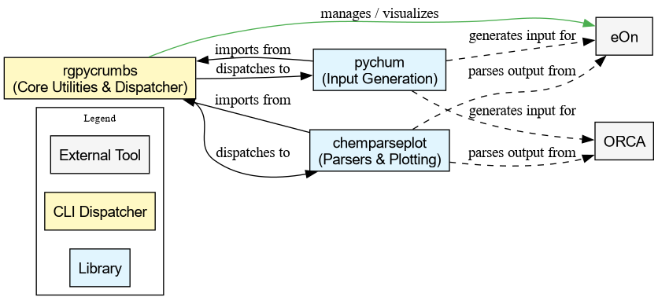

# Table of Contents

- [About](#about)
  - [Ecosystem Overview](#ecosys)
  - [CLI Design Philosophy](#cli-how)
  - [Documentation](#docs)
- [Usage](#usage)
  - [Library API](#library-api)
  - [CLI Tools](#cli-tools)
    - [eOn](#cli-eon)
- [Contributing](#contributing)
  - [Development](#development)
    - [Branch Structure](#dev:branch)
    - [When is pixi needed?](#dev:whypixi)
    - [Versioning](#dev:versions)
  - [Release Process](#release-notes)
- [License](#license)

> This Org file is the canonical source for contributor-facing documentation.
> Do not edit the Markdown files rendered from it.


<a id="about"></a>

# About


[](https://github.com/HaoZeke/rgpycrumbs/actions/workflows/ci_test.yml) [](https://github.com/HaoZeke/rgpycrumbs/actions/workflows/ci_prek.yml) [](https://github.com/HaoZeke/rgpycrumbs/actions/workflows/ci_docs.yml) [](https://pypi.org/project/rgpycrumbs/) [](https://pypi.org/project/rgpycrumbs/) [](https://opensource.org/licenses/MIT) [](https://onegoodtutorial.org/about/badge/?v=1) [](https://github.com/HaoZeke/asv-perch) [](https://github.com/pypa/hatch) [](https://doi.org/10.5281/zenodo.18529798)

A **pure-python** computational library and CLI toolkit for chemical physics research.
`rgpycrumbs` provides both importable library modules for computational tasks (surface fitting, structure analysis, interpolation) and a dispatcher-based CLI for running self-contained research scripts.

Heavy optional dependencies (JAX, SciPy, ASE) are resolved lazily at first use.
A bare `pip install rgpycrumbs` gives the full API surface.
The actual backend libraries load on demand from the current environment, a shared cache, or (with `RGPYCRUMBS_AUTO_DEPS=1`) via automatic `uv` installation.
CUDA-aware resolution avoids pulling GPU libraries on CPU-only machines.

The library side offers:

- Surface fitting in `rgpycrumbs.surfaces`, with JAX-based kernel methods and gradient-enhanced variants for interpolating energy surfaces.
  Its kernels are thin plate splines (TPS), radial basis functions (RBF), Matérn, squared exponential and inverse multiquadric (IMQ).
- Structure analysis in `rgpycrumbs.geom.analysis`, with distance matrices, bond matrices and fragment detection through ASE.
- Structure matching in `rgpycrumbs.geom.ira` by iterative rotations and assignments (IRA), for comparing structures by RMSD.
- Spline interpolation utilities in `rgpycrumbs.interpolation`.
- Shared data structures for NEB paths, saddle searches and molecular geometries in `rgpycrumbs.basetypes`.

The CLI tools rely on optional dependencies fetched on-demand via PEP 723 + `uv`.


<a id="ecosys"></a>

## Ecosystem Overview

`rgpycrumbs` is the central hub of an interlinked suite of libraries.




<a id="cli-how"></a>

## CLI Design Philosophy

The library is designed with the following principles in mind:

- Dispatcher-Based Architecture
  
  The top-level `rgpycrumbs.cli` command is a lightweight dispatcher.
  It does not contain the core logic of the tools itself.
  Instead, it parses user commands to identify the target script and then invokes it in an isolated subprocess using the `uv` runner.
  The tools share one command-line interface but stay decoupled.

- Isolated & Reproducible Execution
  
  Each script is a self-contained unit that declares its own dependencies via [Python Enhancement Proposal (PEP) 723](https://peps.python.org/pep-0723/) metadata.
  The `uv` runner uses this information to resolve and install the exact required packages into a temporary, cached environment on-demand.
  This design guarantees reproducibility and eliminates the risk of dependency conflicts between different tools in the collection.

- Lightweight Core, On-Demand Dependencies
  
  The installable `rgpycrumbs` package has minimal core dependencies (`click`, `numpy`).
  Heavy scientific libraries are not available as optional extras.
  CLI tools fetch deps via PEP 723 and `uv`.
  Library modules use `ensure_import` and `RGPYCRUMBS_AUTO_DEPS`.
  Dependencies are fetched by `uv` only when a script that needs them is executed.
  For library modules, `ensure_import` resolves dependencies at first use when `RGPYCRUMBS_AUTO_DEPS=1` is set, with CUDA-aware resolution that avoids pulling GPU libraries on CPU-only machines.
  The base installation stays lightweight either way.

- Modular & Extendable Tooling
  
  Each utility is an independent script.
  This modularity simplifies development, testing, and maintenance, as changes to one tool cannot inadvertently affect another.
  New tools can be added to the collection without modifying the core dispatcher logic.


<a id="docs"></a>

## Documentation

The manual is at <https://rgpycrumbs.rgoswami.me/>, built from the Org files under [docs/orgmode/](https://github.com/HaoZeke/rgpycrumbs/tree/main/docs/orgmode).
Its map, [llms.txt](https://rgpycrumbs.rgoswami.me/llms.txt), lists the pages with a line on what each covers, and [llms-full.txt](https://github.com/HaoZeke/rgpycrumbs/blob/main/llms-full.txt) has every page but the API reference in one Markdown file, generated by `scripts/llms/build_llms.py`.
[AGENTS.md](https://github.com/HaoZeke/rgpycrumbs/blob/main/AGENTS.md) has the build, test and documentation commands and the mistakes that are easy to make.
[skills/](https://github.com/HaoZeke/rgpycrumbs/tree/main/skills) has task guides with scripts that CI runs: running a tool and pinning what it installs, barriers and figures from an eOn NEB run, and adding a tool.


<a id="usage"></a>

# Usage


<a id="library-api"></a>

## Library API

The library modules can be imported directly.
Dependencies resolve automatically when `RGPYCRUMBS_AUTO_DEPS=1` is set (requires `uv` on PATH), or install extras explicitly:

```
# Surface fitting (requires jax: pip install jax  # or AUTO_DEPS)
from rgpycrumbs.surfaces import get_surface_model
model = get_surface_model("tps")

# Structure analysis (requires ase, scipy: export RGPYCRUMBS_AUTO_DEPS=1)
from rgpycrumbs.geom.analysis import analyze_structure

# Spline interpolation (requires scipy: pip install scipy  # or AUTO_DEPS)
from rgpycrumbs.interpolation import spline_interp

# Data types (no extra deps)
from rgpycrumbs.basetypes import nebpath, SaddleMeasure
```


<a id="cli-tools"></a>

## CLI Tools

The general command structure is:

```
python -m rgpycrumbs.cli [subcommand-group] [script-name] [script-options]
```

You can see the list of available command groups:

```
$ python -m rgpycrumbs.cli --help
Usage: rgpycrumbs [OPTIONS] COMMAND [ARGS]...

  A dispatcher that runs self-contained scripts using 'uv'.

Options:
  --help  Show this message and exit.

Commands:
  eon  Dispatches to a script within the 'eon' submodule.
```


<a id="cli-eon"></a>

### eOn

- Plotting NEB Paths (`plt-neb`), stitch (`plt-neb-stitch`), dimers (`gen-dimer`), KMC (`plt-kmc`)

  Library (no CLI argv): `from rgpycrumbs.eon import plot_neb` then `plot_neb(plot_type="profile", con_file="neb.con", output_file="1D.png")`.
  
  `plt-neb` can show energies in another unit and draw its structure strips with xyzrender.
  `plt-neb-stitch` builds a continuous band from multi-segment minimizations (v1.8+).
  `gen-dimer` seeds saddle searches from NEB peaks.
  `plt-kmc` plots kinetic Monte Carlo (KMC) timelines.
  `plt-min` takes `--energy-cap` or `--energy-cap-window` to clip high energies before the surface fit and the color scale.
  
  eOn **job-config** authorship (`write_eon_config`, `seed_dimers`, MLflow hydrate) needs `eon-schema>=0.2` (`pip install 'rgpycrumbs[eon]'`).
  Plotting still goes through `chemparseplot`.
  The `config.ini` tooling does **not** need eon-akmc.

- Plotting NEB Paths (`plt-neb`) detail

  This script plots the energy surface of Nudged Elastic Band (NEB) calculations in 2D, with optional structure rendering.
  
  The default `grad_imq` method uses gradient-enhanced Inverse Multiquadric interpolation on 2D root-mean-square deviation (RMSD) projections [1].
  The approach projects high-dimensional structures onto 2D coordinates (reactant distance `r` vs product distance `p`) and fits a smooth surface using energy values and their gradients.
  
  [1] R. Goswami, "Two-dimensional RMSD projections for reaction path visualization and validation," *MethodsX*, p. 103851, Mar. 2026, doi: [10.1016/j.mex.2026.103851](https://doi.org/10.1016/j.mex.2026.103851).
  generating 2D surface plots with optional structure rendering.
  
  - Basic Usage
  
    This command writes the 2D surface plot of the path in `trajectory.con` to `neb_landscape.png`.
    
    ```
    python -m rgpycrumbs.cli eon plt-neb --con-file trajectory.con --plot-type landscape -o neb_landscape.png
    ```
  
  - Key Options
  
    | Option | What it does | Default |
    | --- | --- | --- |
    | `--con-file PATH` | Trajectory file with NEB images | None |
    | `--plot-type` | `landscape` (2D surface) or `profile` | `profile` |
    | `--surface-type` | Surface method: `grad_imq`, `grad_matern`, `grad_imq_ny`, `rbf` | `grad_imq` |
    | `--project-path` / `--no-project-path` | Project to reaction valley coordinates | `--project-path` |
    | `--plot-structures` | Structure strip: `none`, `all`, `crit_points` | `none` |
    | `--energy-unit` | Presentation unit: `eV`, `kcal/mol`, `kJ/mol` | `eV` |
    | `--strip-renderer` | Structure renderer backend | `xyzrender` |
    | `--xyzrender-config` | xyzrender preset used for strips | `paton` |
    | `--show-legend` | Show colorbar legend | Off |
    | `--show-pts` / `--no-show-pts` | Show data points on surface | `--show-pts` |
    | `--landscape-path` | Path overlay: `final`, `all`, `none` | `final` |
    | `--ira-kmax` | kmax factor for IRA RMSD calculation | 14.0 |
    | `-o PATH` | Output image filename | None (display) |
    
    Use `--landscape-path all` to overlay all optimization steps and visualize convergence.
    This shows the full trajectory from initial guess to final path [1].
  
  - Examples
  
    This example draws the 2D surface from the gradient-enhanced Matérn kernel, with the reactant, saddle point and product structures.
    
    ```
    python -m rgpycrumbs.cli eon plt-neb \
      --con-file neb.con \
      --plot-type landscape \
      --project-path \
      --plot-structures crit_points \
      --surface-type grad_matern \
      --ira-kmax 14 \
      --energy-unit kJ/mol \
      --show-legend \
      -o neb_landscape.png
    ```
    
    The next plot has the surface alone, without the structure strip.
    
    ```
    python -m rgpycrumbs.cli eon plt-neb \
      --plot-type landscape \
      --surface-type grad_matern \
      --no-show-pts \
      -o surface.png
    ```
    
    The last plot overlays every optimization step to show the convergence.
    
    ```
    python -m rgpycrumbs.cli eon plt-neb \
      --con-file neb.con \
      --plot-type landscape \
      --landscape-path all \
      --surface-type grad_imq \
      --show-legend \
      -o neb_convergence.png
    ```
  
  - Surface Models
  
    - `grad_imq`, the gradient-enhanced inverse multiquadric, uses energies and gradients and is the recommended choice.
    - `grad_matern`, the gradient-enhanced Matérn 5/2, also uses energies and gradients.
    - `grad_imq_ny` applies the Nyström approximation to `grad_imq` for large datasets of more than 1000 points.
    - `rbf` fits a thin plate spline, which is fast and needs no gradients.

- Splitting `.con` files (`con-splitter`)

  This script takes a multi-image trajectory file (e.g., from a finished NEB calculation) and splits it into individual frame files, creating an input file for a new calculation.
  
  To split a trajectory file:
  
  ```
  rgpycrumbs eon con-splitter neb_final_path.con -o initial_images
  ```
  
  This will create a directory named `initial_images` containing `ipath_000.con`, `ipath_001.con`, etc., along with an `ipath.dat` file listing their paths.


<a id="contributing"></a>

# Contributing

All contributions are welcome, but for the CLI tools please follow [the advice on Python script structure at realpython.com](https://realpython.com/python-script-structure/).


<a id="development"></a>

## Development

This project uses [`uv`](https://docs.astral.sh/uv/) as the primary development tool with [`hatchling`](https://hatch.pypa.io/) + [`hatch-vcs`](https://github.com/ofek/hatch-vcs) for building and versioning.

```
# Clone and install in development mode with test dependencies
uv sync --extra test

# Run the pure tests (no heavy optional deps)
uv run pytest -m pure

# Run interpolation tests (needs scipy)
uv run --extra interpolation pytest -m interpolation
```


<a id="dev:branch"></a>

### Branch Structure

Development happens on the `main` branch.
The `readme` branch is an auto-generated orphan containing only the rendered `README.md` and branding assets.
It is the GitHub default branch.


<a id="dev:whypixi"></a>

### When is pixi needed?

[Pixi](https://prefix.dev/) is mainly needed for pixi-only or heavy optional packages that we do not auto-install by default:

- The `fragments` tests need `tblite`, `ira_mod`, and `pyvista`.
- Some heavy visualization workflows may still be easier to manage in pixi.

For everything else, `uv` is sufficient.


<a id="dev:versions"></a>

### Versioning

Versions are derived automatically from **git tags** via `hatch-vcs` (setuptools-scm).
There is no manual version field.
The version is the latest tag, so tag `v1.0.0` gives version `1.0.0`.
Between tags, dev versions are generated automatically (e.g. `1.0.1.dev3+gabcdef`).


<a id="release-notes"></a>

## Release Process

```
# 1. Run the same checks the tag-triggered release workflow expects
uv sync --extra test --extra release
uv run --extra test pytest -m pure
uv run --extra test pytest --pep723-check -m pep723 --override-ini="python_files=" --ignore=rgpycrumbs/chemgp rgpycrumbs/
uvx prek run -a -vvv
pixi run -e docs docbld

# 2. Preview the next semantic version from Conventional Commits
#    cog is not on PyPI; cargo builds it from the cocogitto crate,
#    which needs a Rust toolchain with edition 2024 support
cargo install --locked cocogitto@7.0.0
V=$(cog bump --dry-run --auto)
V=${V#v}
: "${V:?cog bump --dry-run --auto printed no version}"

# 3. Build the release notes from towncrier fragments
#    towncrier headings use X.Y.Z, while the git tag stays vX.Y.Z
uvx towncrier build --version "${V:?}"

# 4. Commit the release notes (historically: release: vX.Y.Z)
git add CHANGELOG.rst docs/newsfragments
git commit -m "release: v${V:?}"
python3 scripts/check_version.py

# 5. Tag the release commit (hatch-vcs derives the package version from tags)
cog bump --auto

# 6. Push main and tags; GitHub Actions handles build/publish/release
git push origin main --tags
```

The existing `.github/workflows/release.yml` publishes to PyPI and creates the GitHub release when a `v*` tag is pushed.


<a id="license"></a>

# License

`rgpycrumbs` is under the Massachusetts Institute of Technology (MIT) License.
This is an academic resource, so **please cite** it as much as possible via:

- The [Zenodo digital object identifier (DOI)](https://doi.org/10.5281/zenodo.18529798) for general use.
- The `wailord` paper for work with the quantum chemistry program (ORCA).

